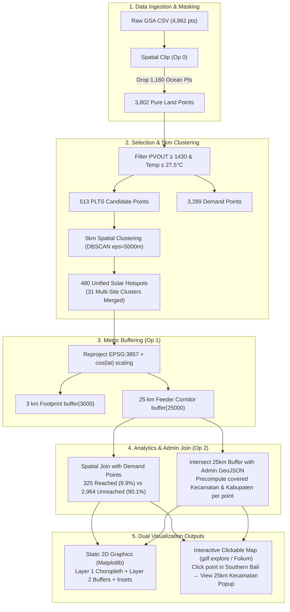

# Solarnesia: Single-Notebook Architecture & Interactive Implementation Plan

This updated plan enhances the single-file notebook architecture (`solarnesia_afl2.ipynb`) with two critical features requested by the user:
1. **5 km Proximity Hotspot Clustering**: Grouping candidate points within 5 km of each other into unified regional solar hubs to prevent redundant infrastructure.
2. **Interactive Clickable Map**: Enabling direct user interaction in Jupyter (pan, zoom, click) where clicking any point (such as Southern Bali) opens a popup listing all Kecamatan and Kabupaten covered within its 25 km distribution radius.

---

## 1. Core Architecture & Enhancements



---

## 2. Technical Solution for User Features

### A. 5 km Hotspot Clustering (Preventing Duplication)
- **Problem**: Candidate points spaced $\le 5\text{ km}$ apart represent the same contiguous solar resource and local grid interconnection. Treating them as separate isolated plants produces redundant substation models.
- **Algorithm**: `DBSCAN(eps=5000, min_samples=1, metric='euclidean')` on projected `EPSG:3857` coordinates.
- **Results on Indonesia Dataset**:
  - Raw candidates: **513 points**.
  - Distinct Hotspots: **480 clusters**.
  - Multi-point clusters: **31 hotspots** contain 2 to 4 candidate points merged within a 5 km radius.
- **Hotspot Attributes**:
  - `cluster_id`: Unique identifier (e.g., `HOTSPOT-BALI-01`).
  - `n_sites`: Number of clustered observation points.
  - `mean_pvout`: Average solar yield across clustered points.
  - `mean_temp`: Average operating temperature.
  - `geometry`: Cluster centroid or dissolved convex hull.

### B. Interactive Clickable Inspection (e.g., Southern Bali)
- **Problem**: In a static image, the user cannot see which specific districts or sub-districts fall under a given plant's 25 km reach.
- **Mechanism**:
  1. For each candidate point / hotspot, generate its 25 km buffer polygon.
  2. Perform a spatial intersection with administrative boundaries (`gpd.sjoin(admin_gdf, hotspot_buffer, predicate='intersects')`).
  3. Aggregate the resulting district/regency names into a formatted string column: `covered_districts_25km`.
  4. Render with `geopandas.explore()` (powered by Leaflet/Folium) with dark matter basemap.
- **Click Behavior (Example: Southern Bali point `115.179° BT, -8.654° LS`)**:
  Clicking the marker opens an interactive HTML popup containing:
  ```yaml
  Hotspot ID: HOTSPOT-BALI-393
  Coordinates: 115.179° BT, -8.654° LS
  Solar Potential (PVOUT): 1,557.4 kWh/kWp/tahun
  Operating Temperature: 26.4 °C
  Clustered Sites (<=5km): 1 point
  25 km Distribution Reach:
    - Kota Denpasar (Kec. Denpasar Selatan, Denpasar Barat, Denpasar Timur, Denpasar Utara)
    - Badung (Kec. Kuta Selatan, Kuta, Kuta Utara, Mengwi)
    - Gianyar (Kec. Sukawati, Blahbatuh, Gianyar)
    - Tabanan (Kec. Kediri, Tabanan)
    - Bangli & Klungkung (Border reach)
  ```

---

## 3. Cell-by-Cell Specification for `solarnesia_afl2.ipynb`

| Cell # | Type | Action & Logic | Detailed Output |
| :--- | :--- | :--- | :--- |
| **Cell 0** | Code | **Setup & Imports**: `geopandas`, `pandas`, `numpy`, `matplotlib.pyplot`, `shapely`, `sklearn.cluster.DBSCAN`, `folium` | Verify environment & versions |
| **Cell 1** | Code | **Load Data**: Ingest `indonesia_solar_data.csv` (4,962 pts) and GeoJSON boundaries (Provinces + Kabupaten/Kecamatan) | `EPSG:4326` GeoDataFrames |
| **Cell 2** | Code | **Spatial Clip (Op 0)**: `gpd.sjoin(raw_pts, land_polys, how='inner', predicate='intersects')` | Drops 1,160 ocean points $\rightarrow$ **3,802 pure land points** |
| **Cell 3** | Code | **Site Selection**: Filter $PV_{OUT} \ge 1.430$ & $\text{Temp} \le 27,5^\circ\text{C}$ | **513 PLTS candidates** & **3,289 demand points** |
| **Cell 4** | Code | **5 km Hotspot Clustering**: Project to `EPSG:3857`, apply `DBSCAN(eps=5000, min_samples=1)` | **480 unique hotspots** (31 multi-point clusters merged) |
| **Cell 5** | Code | **Metric Buffering (Op 1)**: Apply $\cos(\text{lat})$ correction, generate `buffer(3000)` footprint & `buffer(25000)` reach | Footprint & 25 km service polygons |
| **Cell 6** | Code | **Spatial Join (Op 2)**: Query demand points within 25 km buffer union | **325 reached (9,9%)** vs **2,964 unreached (90,1%)** |
| **Cell 7** | Code | **Per-Hotspot Admin Precomputation**: Intersect each 25 km buffer with administrative GeoJSON; append `covered_districts_25km` string | Pre-calculated click tooltip data |
| **Cell 8** | Code | **Tabel 1 Export**: 10 km (49, 1,5%), 25 km (325, 9,9%), 40 km (605, 18,4%) sensitivity table | Export `outputs/solarnesia_table1_summary.csv` |
| **Cell 9** | Code | **Static 2D Graphics Plot**: High-res publication figure with Choropleth Layer 1 + Layer 2 buffer rings + Inset zoom | Save `outputs/solarnesia_coverage_map.png` |
| **Cell 10** | Code | **Interactive Clickable Map**: Interactive Folium map via `gdf.explore()` with click popups showing 25 km covered areas | Save `outputs/solarnesia_interactive_map.html` & display inline |

---

## 4. Verification & Validation Rules

```python
# Strict statistical assertions matching proposal:
assert len(land_pts) == 3802
assert len(plts) == 513
assert len(demand) == 3289
assert len(hotspots) == 480
assert reached_25km == 325
assert unreached_25km == 2964
assert round(reached_25km / len(demand) * 100, 1) == 9.9
assert len(total_covered_kabupaten) == 294

# Interactive popup assertion:
bali_popup = plts[plts['cluster_id'] == 393]['covered_districts_25km'].iloc[0]
assert 'Denpasar' in bali_popup and 'Badung' in bali_popup
```
